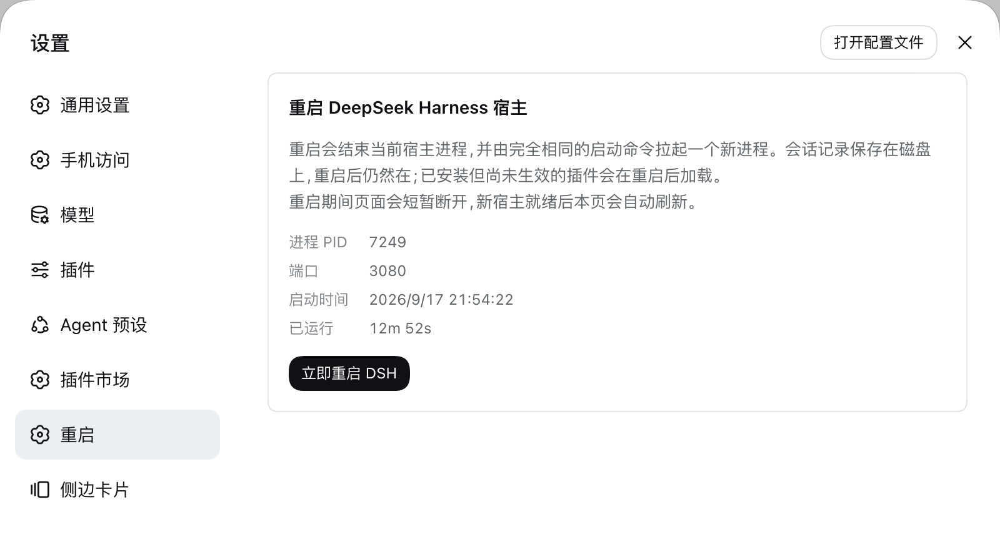

# dsh-restart

English | [中文](README.zh.md)

A **Restart** page in the DeepSeek Harness (dsh) Web settings panel: one button replaces the running host process with a fresh one.



## What it does

- **Host half** registers three routes on the Web server, all limited to direct same-origin loopback requests:
  - `GET /dsh-restart/status` — boot id, PID, start time, and serving port of the current process
  - `POST /dsh-restart/restart` — replaces the current process (the host exits after answering `202`)
  - `POST /dsh-restart/stop` — ends the current process and starts nothing (same ordering)
- **Browser half** registers a `settings.section` page showing that identity, a restart button, and a stop button.
- **Shortcut** — <kbd>Cmd</kbd>+<kbd>Option</kbd>+<kbd>R</kbd> (macOS) or <kbd>Ctrl</kbd>+<kbd>Alt</kbd>+<kbd>R</kbd> (Windows) restarts the host without opening settings. It is page-scoped, so it never fires while a composer or another editable surface has focus, and it appears with its label on the settings *Keyboard* page. Web on Linux is left unbound: the client's shortcut allowlist rejects every `primary+alt` chord there, so registering one would fail the plugin's activation. After a restart it polls `/dsh-restart/status` and reloads the page as soon as a different boot id answers; after a stop there is nothing to wait for, so the page reports success once the status route stops answering — and says plainly that starting again means running the launch command in a terminal.

The restart itself is done by a detached helper: the host exits after 400 ms, and the helper waits until the port stops accepting connections before spawning the replacement with **exactly the same launch invocation** (Node binary, `execArgv`, absolute entry path, remaining argv, working directory). That ordering is what keeps the replacement from dying of `EADDRINUSE` while the old socket is still held. Logs land in the system temp directory as `dsh-restart-<timestamp>.out.log` / `.err.log`.

A stop is the same 400 ms `SIGTERM` with no helper behind it, which is what lets the CLI flush sessions and dispose plugins before its own escalation timer forces the exit. Because a stopped host has no replacement, the process you restart from the page is also the one no longer attached to your terminal — after any restart, stopping it means this button, `kill <pid>`, or `curl -X POST http://127.0.0.1:<port>/dsh-restart/stop`.

Sessions live on disk and survive the restart, and plugins that are installed but not active yet load on the next boot.

## Install

```sh
# from GitHub
dsh plugin --profile web add github:DWJZ/dsh-restart

# local development (the profile links the checkout, so edits apply directly)
dsh plugin --profile web add link:/path/to/dsh-restart
```

The first install needs one restart before the page exists — restart the host from a terminal, or use dshmarket's restart button once. After that, this page is the way to restart.

## Endpoint contract

`POST /dsh-restart/restart` accepts only requests whose peer is loopback and whose `Origin` matches `Host`; any forwarding header (`Forwarded`, `X-Forwarded-For`, `X-Real-IP`) or non-loopback peer is refused with `403`. It answers `202`, then the host exits and the helper starts the replacement.

`POST /dsh-restart/stop` takes the same guard and answers `202` before exiting, so the browser learns the outcome from the response instead of from a dropped connection. It never sends `SIGKILL`: the graceful signal is what flushes sessions.

## Test

```sh
node test/smoke.mjs
```

Covers: the detached helper really starts a replacement process, all four refusal paths of the same-origin guard, and the client bundle's registration and render. Set `DSH_CHECKOUT=<dsh checkout>` to add an SSR render assertion using that checkout's React; without it that one assertion is skipped.

## License

[MIT](LICENSE)
